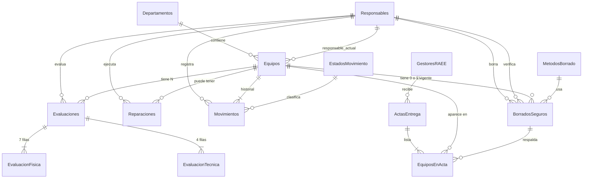

# Etapa 3 — Modelo entidad-relación

Diagrama conceptual del sistema. 14 entidades, todas con origen en el PDF (columna "De dónde sale" del [mapa](02_mapa_documento_bd.md)).

## Diagrama (Mermaid)



## Cardinalidades en texto

- Un **Departamento** contiene N **Equipos**; un equipo pertenece a un solo departamento.
- Un **Responsable** puede ser el actual de N equipos, y aparece como firmante en evaluaciones, reparaciones, movimientos y borrados.
- Un **Equipo** tiene:
  - 0..N `Evaluaciones` (una por fecha).
  - 0..N `Reparaciones`.
  - 0..1 `BorradoSeguro` vigente (constraint UNIQUE parcial en la Etapa 4).
  - 1..N `Movimientos` (mínimo el `REGISTRADO`).
  - 0..1 fila en `EquiposEnActa` (cuando ya salió al gestor).
- Cada `Evaluacion` tiene **exactamente** 7 `EvaluacionFisica` (los 7 elementos del Anexo C) y **exactamente** 4 `EvaluacionTecnica` (los 4 aspectos).
- Una `ActaEntrega` va a **un** `GestorRAEE` y agrupa N `EquiposEnActa`.

## Estados del ciclo de vida (catálogo `EstadosMovimiento`)

```
      +-------------+
      | REGISTRADO  |
      +------+------+
             |
             v
   +--------------------+
   | EN_ALMACEN_TEMPORAL|
   +--------+-----------+
            |
            v
     +-------------+
     |EN_EVALUACION|
     +------+------+
            |
    +-------+-------+------------------+
    v               v                  v
+------------+ +------------+  +--------------------+
| CLASIFI_   | | CLASIFI_   |  | CLASIFI_           |
| REUTILIZ   | | REPARABLE  |  | NO_RECUPERABLE     |
+-----+------+ +----+-------+  +----------+---------+
      |             |                     |
      v             v                     v
+-----------+  +-----------+     +----------------+
| REASIGNADO|  |EN_         |    | BORRADO_SEGURO|
+-----+-----+  |REPARACION  |    | APLICADO       |
      |        +----+-------+    +----+-----------+
      v             |                 |
+----------+        v                 v
| CERRADO  | (back to EN_EVAL)   +----------------+
+----------+                     | ENTREGADO_A_   |
                                 | GESTOR         |
                                 +--------+-------+
                                          |
                                          v
                                   +-----------+
                                   |  CERRADO  |
                                   +-----------+
```

Un equipo REUTILIZABLE puede saltarse el borrado seguro si se reasigna dentro de la empresa; cualquier equipo que salga (`ENTREGADO_A_GESTOR`) tiene que pasar por `BORRADO_SEGURO_APLICADO` primero — se valida por trigger o por Python.

Este mismo grafo es el **diagrama de flujo del Anexo A** del proyecto, y es lo que Python implementará en la Etapa 6 (programa mínimo del flujo) y en la Etapa 8 (GUI).
